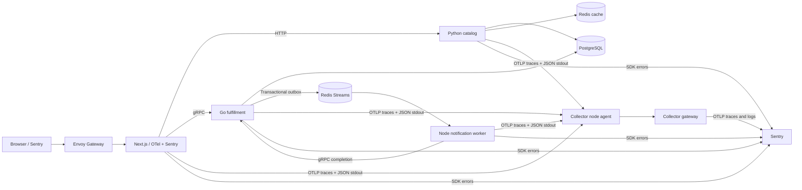

# Sentry + OpenTelemetry Kubernetes workshop

A polyglot control centre for [Sentry & OpenTelemetry: Add connected context to your OTel signals](https://sentry.io/resources/otel-connected-context-workshop/).

Click a scenario, then follow one workflow through browser, HTTP, gRPC, PostgreSQL, Redis and a background worker. OpenTelemetry produces backend traces. Kubernetes collects JSON stdout logs. Sentry SDKs attach application errors to the active OTel spans.



## Quick start

Requirements: macOS or Linux, Python 3, a running Docker-compatible runtime with at least 4 CPUs/8 GiB memory and 20 GiB free disk. macOS Colima and Docker Desktop are supported runtime choices; existing runtime settings are preserved. Native Windows is not covered; use WSL2 with a Docker runtime. The presenter baseline was exercised on a runtime allocated 7 CPUs and 18 GiB memory; the smaller attendee allocation is a sizing requirement, not a separately tested configuration.

Run these commands from the repository root:

```sh
cp .env.example .env
# Set DOCKER_CONTEXT; fill project DSNs, Sentry credentials and the upload token.
# Replace all database/Redis password placeholders.
make bootstrap
make doctor
make up             # Uploads/processes JS source maps before deployment
make verify
make verify-sentry
```

Open [http://localhost:8080](http://localhost:8080). Tools and kubeconfig stay in ignored `.local/`; only the named `sentry-otel-workshop` cluster is managed. Initial setup downloads images and compiles four services. `make doctor`, `make build` and `make up` require `SENTRY_SOURCE_MAP_AUTH_TOKEN`. Both JavaScript builds upload their matching maps and wait up to 120 seconds for Sentry processing before deployment; a failed upload fails the build.

The five expected project slugs are `sentry-otel-workshop-web`, `sentry-otel-workshop-catalog`, `sentry-otel-workshop-fulfillment`, `sentry-otel-workshop-worker`, and `sentry-otel-workshop-infrastructure`. Create them in your own organization, on your selected team. Browser and server use the web project's DSN.

Main exporter mode requires Organization Read and Project Read credentials. An authenticated `sentry` CLI can provide the presenter's credential without printing it in setup output. Alternatively, create a limited Internal Integration. Set `SENTRY_EXPORTER_MODE=otlphttp` to use static per-project OTLP endpoints without a management token. See [collector configuration](docs/plan/04-collector-and-sentry.md). That guide distinguishes collector read scopes, the additional Events Read permission for automated verification, and the separate upload token. `make verify-sentry` needs an authenticated read token even when static OTLP export uses no management credential.

## Scenarios

| Button | Expected result | Inspect in Sentry |
| --- | --- | --- |
| Complete journey | Order completes through worker | Four services in one trace |
| Cache miss → hit | One DB-backed lookup, then a cache hit | Redis and PostgreSQL client spans |
| Database contention | A real 750ms PostgreSQL lock timeout | One Python issue, failed SQL span and native database logs |
| Slow database | Successful lookup with a 1.2-second DB delay | Database span explains latency |
| Python exception | Failed run before order creation | Python issue, exact span, surrounding logs |
| Go exception | Failed reservation rolls back | Go issue, transaction span, unchanged inventory |
| Background job: Recover on attempt 3 | Third attempt succeeds | Three consumer spans, retry logs |
| Background job: Exhaust → dead letter | Third attempt ends in dead letter | One Node issue and dead-letter evidence |
| Next.js exception | Failure before catalog lookup | Server issue linked to OTel |
| Browser exception | Browser exception recorded against run | Browser span and SDK issue |

Each injected failure has one originating logical SDK event. Worker transport replays use the same stable event ID. The worker is simulated: no external notification is sent. All data is synthetic.

## Revised workshop flow

Ben opens with 15 minutes on OTel, Sentry and the integration, followed by a 35-minute demo and 10 minutes of questions. The control centre starts with five scenarios: healthy journey, cache comparison, slow PostgreSQL, database contention and background jobs. The original synthetic errors are available under **More examples**. See the [attendee guide](docs/workshop/attendee-guide.md) for exercises.

Only routine **PostgreSQL and Redis infrastructure logs** are sampled, at 5% by default (`OTEL_INFRA_LOG_SAMPLE_PERCENT=5`; accepts 5, 10 or 100). Application logs and traces retain their existing 100% behavior and health-check exclusions. Native warnings/errors, slow-query and lock-wait evidence are retained. Both exporter routes apply the same policy. PostgreSQL logs can link to the real catalog business span through `application_name`; Redis native logs are investigated by component, pod and time. This is probabilistic log sampling; trace tail sampling is outside this revision.

## Operate and verify

```sh
make k9s              # Open the workshop Kubernetes terminal UI
make test             # Service behavior and contract checks
make verify           # Application + cluster acceptance checks
make verify-sentry    # Real telemetry ingestion checks
make verify-collector # Collector parser/sampling fixtures, both exporters
make verify-infra     # Native infrastructure incidents and retention in Sentry
make demo-infra-sampling # Finite 100% vs 5% infrastructure-log comparison
make demo-redis-busy  # Fixed read-only Redis script and authentic warning
make verify-recovery  # Isolated worker crash + SDK outage check
make reset-demo       # Reset only workshop data; preserve Sentry history
make down             # Stop this project's port-forward
make forward          # Resume forwarding for the existing cluster
make cluster-delete   # Delete only this project's named kind cluster
```

Install K9s with `brew install derailed/k9s/k9s`, then run `make k9s` or `./scripts/k9s.sh`. The launcher selects the dedicated workshop kubeconfig, context, and namespace. To launch it from any directory, install a shortcut with `mkdir -p ~/.local/bin && ln -s "$PWD/scripts/k9s.sh" ~/.local/bin/workshop-k9s`, then run `workshop-k9s`.

`make source-map-upload` is an optional recovery command for maps from the exact running images; normal builds already upload them. The verification scripts fail explicitly when evidence is missing. Their strict visibility window defaults to 120 seconds; an explicit `WORKSHOP_VERIFICATION_TIMEOUT_SECONDS=300 make verify-infra` (or `make verify-sentry`) allows a longer rehearsal window when remote telemetry visibility lags. This changes only verification waiting, not application deadlines or sampling. Current execution evidence is stored in ignored `.local/verification`; [validation](docs/plan/06-validation.md) defines the required proof. Re-deploying is idempotent. Reset temporarily stops the four application workloads, reseeds fixtures and creates a new session. Reload the control-centre page afterward so it reads that session. Reset is separate from cluster deletion.

## Developer tests

`make up` builds Python and Go inside pinned containers. To run `make test` on the host, install uv (0.9.4 or newer), Python 3.13 and Go 1.25 or newer. Bootstrap supplies the pinned Node runtime; install the locked JavaScript and Python development dependencies before testing:

```sh
make bootstrap
export PATH="$PWD/.local/bin:$PATH"
make deps             # npm ci in both JS packages; uv sync --frozen for Python
make test             # also runs make deps before the service tests
make verify-recovery
```

Both `npm --prefix apps/web run build` and `npm --prefix services/notification-worker run build` read the repository-root `.env`, with explicit environment variables taking precedence. When an upload token is configured, they compile, inject debug IDs and upload/process source maps automatically. An isolated build without a token compiles with a clear upload-skipped message; the full workshop build requires the token. Docker receives it only through a BuildKit secret, never a build argument or image environment variable.

The recovery check uses a disposable Redis container with the same pinned image as the cluster, actual worker processes, and local fake gRPC/Sentry receivers. It kills the worker after durable error handoff, restarts it, then restores SDK delivery. It checks queue idempotency and trace context without writing to the workshop cluster or external Sentry. Normal completion, failures and Ctrl-C clean up its own container and process groups. Live Sentry ingestion remains a separate `make verify-sentry` check.

## Learn and present

- [Implementation plan](docs/plan/00-overview.md)
- [Attendee exercises](docs/workshop/attendee-guide.md)
- [Troubleshooting](docs/troubleshooting.md)
- [Pinned versions](docs/versions.md)
- [Verification record](docs/verification.md)
- [Public readiness](docs/plan/08-public-readiness.md)

## Important integration boundaries

Backend OTel providers own tracing, exporting and 100% workshop sampling. Sentry backend tracing is disabled; its linking integrations resolve active OTel context. Browser Sentry tracing uses W3C `traceparent`. JSON stdout is the sole application-log path; trace IDs become native OTLP LogRecord fields in the agent.

Sentry currently ingests OTLP traces and logs, not OTLP metrics. OTLP ingestion is beta and the Sentry Exporter is alpha. Exception span events do not replace Sentry SDK error capture. Database, cache and proxy components contribute client spans and infrastructure logs; their upstream binaries do not contain application Sentry SDKs.

The pinned main Sentry Exporter persists unsent queued batches across gateway restarts, but does not retry failed Sentry HTTP deliveries. Static OTLP/HTTP mode explicitly retries transient export failures for up to 120 seconds. See [collector recovery limits](docs/plan/04-collector-and-sentry.md#retry-and-persistence-limits).

This is a single-node workshop system demonstrating at-least-once queue delivery and idempotent effects. It has no production authentication, high availability or exactly-once guarantee. Keep access on localhost.

## License

MIT. This repository is prepared locally; publication is a separate action.
