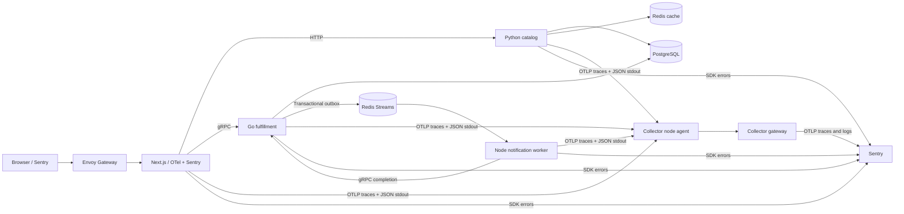

# Sentry + OpenTelemetry Kubernetes workshop

A polyglot control centre for [Sentry & OpenTelemetry: Add connected context to your OTel signals](https://sentry.io/resources/otel-connected-context-workshop/).

Click a scenario, then follow one workflow through browser, HTTP, gRPC, PostgreSQL, Redis and a background worker. OpenTelemetry produces backend traces. Kubernetes collects JSON stdout logs. Sentry SDKs attach application errors to the active OTel spans.



## Quick start

Requirements: macOS or Linux, Python 3, a running Docker-compatible runtime with 4 CPUs/8 GiB memory and 20 GiB free disk. macOS Colima and Docker Desktop are supported runtime choices; existing runtime settings are preserved. Native Windows is not covered; use WSL2 with a Docker runtime.

```sh
cp .env.example .env
# Fill the placeholders with your own Sentry organization and project values.
make bootstrap
make doctor
make up
```

Open [http://localhost:8080](http://localhost:8080). Tools and kubeconfig stay in ignored `.local/`; only the named `sentry-otel-workshop` cluster is managed. Initial setup downloads images and compiles four services.

The five expected project slugs are `sentry-otel-workshop-web`, `sentry-otel-workshop-catalog`, `sentry-otel-workshop-fulfillment`, `sentry-otel-workshop-worker`, and `sentry-otel-workshop-infrastructure`. Create them in your own organization, on your selected team. Browser and server use the web project's DSN.

Main exporter mode requires Organization Read and Project Read credentials. An authenticated `sentry` CLI can provide the presenter's credential without printing it in setup output. Alternatively, create a limited Internal Integration. Set `SENTRY_EXPORTER_MODE=otlphttp` to use static per-project OTLP endpoints without a management token. See [collector configuration](docs/plan/04-collector-and-sentry.md).

## Scenarios

| Button | Expected result | Inspect in Sentry |
| --- | --- | --- |
| Full journey | Order completes through worker | Four services in one trace |
| Cache miss → hit | One DB-backed lookup, then a cache hit | Redis and PostgreSQL client spans |
| Slow PostgreSQL | Successful lookup with a 1.2-second DB delay | Database span explains latency |
| Python catalog error | Failed run before order creation | Python issue, exact span, surrounding logs |
| Go fulfillment error | Failed reservation rolls back | Go issue, transaction span, unchanged inventory |
| Async worker: recover | Third attempt succeeds | Three consumer spans, retry logs |
| Async worker: exhaust | Third attempt ends in dead letter | One Node issue and dead-letter evidence |
| Next.js server error | Failure before catalog lookup | Server issue linked to OTel |
| Browser error | Browser exception recorded against run | Browser span and SDK issue |

Each injected exception is captured once at its origin. The worker is simulated: no external notification is sent. All data is synthetic.

## Operate and verify

```sh
make test             # Service behavior and contract checks
make verify           # Application + cluster acceptance checks
make verify-sentry    # Real telemetry ingestion checks
make verify-recovery  # Isolated worker crash + SDK outage check
make reset-demo       # Reset only workshop data; preserve Sentry history
make down             # Stop this project's port-forward
make cluster-delete   # Delete only this project's named kind cluster
```

The verification scripts fail explicitly when evidence is missing. Current execution evidence is stored in ignored `.local/verification`; [validation](docs/plan/06-validation.md) defines the required proof. Re-deploying is idempotent. Reset temporarily stops the four application workloads and reseeds fixtures; it is separate from cluster deletion.

## Developer tests

`make up` builds Python and Go inside pinned containers. To run `make test` on the host, install uv (0.9.4 or newer), Python 3.13 and Go 1.25 or newer. Bootstrap supplies the pinned Node runtime; install the locked JavaScript and Python development dependencies before testing:

```sh
make bootstrap
export PATH="$PWD/.local/bin:$PATH"
make deps             # npm ci in both JS packages; uv sync --frozen for Python
make test             # also runs make deps before the service tests
make verify-recovery
```

The recovery check uses a disposable Redis container with the same pinned image as the cluster, actual worker processes, and local fake gRPC/Sentry receivers. It kills the worker after durable error handoff, restarts it, then restores SDK delivery. It checks queue idempotency and trace context without writing to the workshop cluster or external Sentry. Normal completion, failures and Ctrl-C clean up its own container and process groups. Live Sentry ingestion remains a separate `make verify-sentry` check.

## Learn and present

- [Implementation plan](docs/plan/00-overview.md)
- [Presenter guide](docs/workshop/presenter-guide.md)
- [Attendee exercises](docs/workshop/attendee-guide.md)
- [Troubleshooting](docs/troubleshooting.md)
- [Pinned versions](docs/versions.md)
- [Public readiness](docs/plan/08-public-readiness.md)

## Important integration boundaries

Backend OTel providers own tracing, exporting and 100% workshop sampling. Sentry backend tracing is disabled; its linking integrations resolve active OTel context. Browser Sentry tracing uses W3C `traceparent`. JSON stdout is the sole application-log path; trace IDs become native OTLP LogRecord fields in the agent.

Sentry currently ingests OTLP traces and logs, not OTLP metrics. OTLP ingestion is beta and the Sentry Exporter is alpha. Exception span events do not replace Sentry SDK error capture. Database, cache and proxy components contribute client spans and infrastructure logs; their upstream binaries do not contain application Sentry SDKs.

This is a single-node workshop system demonstrating at-least-once queue delivery and idempotent effects. It has no production authentication, high availability or exactly-once guarantee. Keep access on localhost.

## License

MIT. This repository is prepared locally; publication is a separate action.
