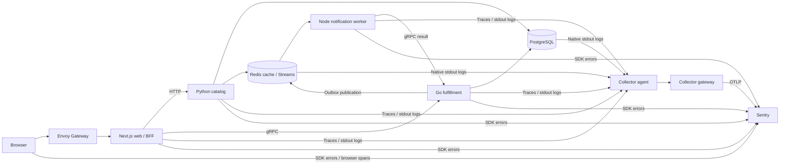

# Outcome and implementation gates

## Decisions

Create a local public-ready repository, no GitHub publishing. Fully verify local Kubernetes, browser/server traces, JSON application logs, native PostgreSQL/Redis logs, and SDK errors in Sentry. Keep application traces/logs at 100%; sample routine infrastructure logs at 5% and retain incident evidence.

## Steps

Create foundation and shared contracts; bootstrap Kubernetes; prove telemetry compatibility; implement workflows; validate and rehearse.

## Acceptance

Healthy distributed trace; exact-span error links; native log trace context; correct application pod attribution; no duplicate exports.

## Completion checklist

- [x] Implementation complete
- [x] Automated checks complete
- [x] Live verification recorded where applicable
- [x] Documentation matches observed behavior

## Architecture

## Prerequisites and runnable baseline

Use the [README prerequisites](../../README.md#quick-start): supported host, selected running Docker context, five Sentry projects, and ignored `.env` with project DSNs, read/upload credentials and database/Redis passwords. Host development tests additionally need the [developer prerequisites](../../README.md#developer-tests).

From the repository root, run `make bootstrap`, `make doctor`, `make up`, then `make verify-sentry`. Expected results: pinned tools pass checks, the named local cluster and four application workloads become ready, JavaScript maps finish processing before deployment, and localhost:8080 serves the control centre. Complete journey reaches `completed`; marked workflows produce correctly routed spans/logs and origin SDK errors with exact-span links. Run all UI cards, including the browser exception, for the full acceptance gate.

## Ordered milestones

1. Foundation: local Git repository, MIT license, configuration placeholders, protobuf and all numbered docs.
2. Kubernetes: checksummed kind/kubectl/Helm, isolated single-node cluster, storage, Gateway API and two Collector roles.
3. Compatibility: a real browser-triggered run across all languages; SDK errors, native log context and project routing.
4. Workflows: deterministic cache/DB/error cards, transactional outbox, single consumer and idempotent retry/DLQ.
5. Acceptance: service tests, database/queue invariants, network isolation, restarts and live Sentry evidence.
6. Delivery: readable JavaScript source, presenter and attendee guides, clean startup/reset rehearsal and public audit.

Each gate requires observed behavior; configuration alone is not live verification. GitHub publication and hosted Kubernetes are excluded.

## Milestones and dependencies

1. Save this design and the shared contract. Commit only public source; local configuration remains ignored.
2. Bootstrap checked tools, create the named kind cluster, then deploy storage and the collector/Envoy foundations.
3. Prove a minimal complete journey in Sentry before accepting additional scenarios. HTTP, gRPC and queue hops must keep one trace ID.
4. Add deterministic cache, latency and origin failures, then prove business invariants independently of telemetry.
5. Verify each signal in its intended Sentry project, including active span IDs and readable source. Rehearse interruptions and exclusive exporter switching.
6. Rehearse reset and repeated deployment, finish the presenter/attendee guides, and audit public files.

The collector cannot replace SDK exception capture. The application never waits for Sentry indexing to determine a run's business state. Verification polls live evidence separately.

## Files to inspect

The nine numbered files in this directory follow the implementation order. Each references runnable commands, prerequisites and acceptance criteria. The source tree keeps protocol definitions in `proto`, collection and networking in `infra`, operational commands in `scripts`, and language-specific code under `apps`/`services`.

## Workshop revision — native infrastructure context

The 60-minute delivery allocates 15 minutes to Ben's OpenTelemetry/Sentry integration introduction, 35 minutes to the five primary demo cards, and 10 minutes to questions. Synthetic language failures remain available in collapsed More examples. See the [presenter flow](../workshop/presenter-guide.md).

Revision order: native PostgreSQL/Redis parsing and infrastructure-only probabilistic log sampling; bounded PostgreSQL contention with native context; focused UI and exercises; live Sentry acceptance and timed rehearsal. Preserve existing exporter routing, SDK ownership, dependency pins, health exclusions, and source-map uploads.

Revision completion requires `make verify-collector`, `make verify`, `make verify-sentry`, and `make verify-infra`, finite sampling/Redis exercises, recovery without data loss, and fresh evidence in ignored `.local/verification`. The checked baseline milestones above describe the initial implementation; new revision acceptance is recorded separately in [verification](../verification.md).
