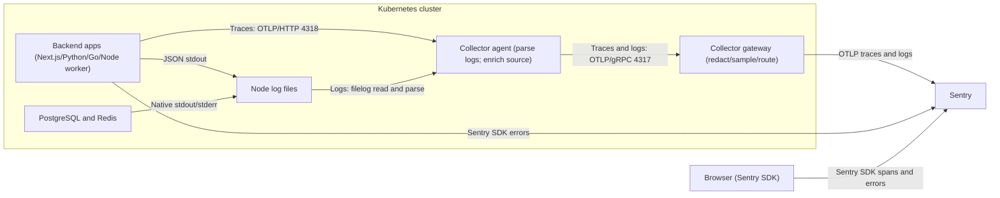

# Presenter guide — 15-minute intro / 35-minute demo / 10-minute Q&A

Ben introduces OpenTelemetry and Sentry; the practical demo follows the five primary cards; both presenters take questions. Times below are elapsed session times, matching the [delivery plan](../plan/07-workshop-delivery.md#timed-sequence). Attendee labs and optional fault injections are outside the timed demo.

## Before the session

1. Start the selected Docker runtime and fill ignored `.env` with project DSNs, collector/read credentials and the separate source-map upload token. For a fresh checkout, run `make bootstrap` before `make doctor`.
2. Run `make up`, `make test`, `make verify-collector`, `make verify`, `make verify-sentry`, and `make verify-infra`. Both JavaScript builds upload matching maps and wait for Sentry processing before deployment; failed upload/processing stops the build. The [credential table](../plan/04-collector-and-sentry.md#credential-scope-by-purpose) explains verification-only token overrides.
3. Prepare already-visible Sentry evidence from the current deployment for every primary scenario, including recover and exhaust worker outcomes. Record each scenario's run/trace ID and originating issue where applicable. The default 120-second visibility gate has failed in rehearsal; successful recorded gates used an explicit `WORKSHOP_VERIFICATION_TIMEOUT_SECONDS=300`. Preserve failures before rerunning with that override; it changes the verification window, not delivery retries. See [recorded visibility limits](../verification.md#visibility-limitation-and-remaining-rehearsal).
4. Run the finite `make demo-infra-sampling` and `make demo-redis-busy` exercises before the session. Keep their measured counts and native warning ready; do not run generators while narrating. Restore the tested exporter mode, normal propagation, 5% routine-log sampling, and UI defaults.
5. Run `make reset-demo`, reload the control-centre page for the new session, and warm one Complete journey. Reset/reload again if a clean run list is preferred. Sentry history survives reset, so keep labeled preflight evidence available rather than mixing it with new run IDs.
6. Open the control centre and Sentry Issues/Traces/Logs. Filter to `workshop-local`, the intended project set, and a suitable time range. Use fresh UI identifiers for fresh runs; if visibility lags, explicitly switch to the labeled current-deployment preflight example.
7. Pre-open the files listed under **15–20 minutes: architecture and collection**, with the named configuration blocks bookmarked. Each later segment lists supporting code to open only if needed; keep Sentry as the main investigation view. All source links below are relative to this guide; displayed paths are repository-relative. Keep tokens, `.env`, kubeconfig, and generated Secrets off screen. Rebuild/redeploy after runtime changes and inspect fresh source-readable errors; `make source-map-upload` is only recovery for the exact running images.
8. Perform one human, spoken 35-minute demo rehearsal. Automated scenario timings are not narration timings. Do not mark rehearsal complete until you have practiced the Sentry navigation and visibility fallback.

## Presentation diagram

Use the Mermaid block below or the [standalone Mermaid source](diagrams/telemetry-flow.mmd) with a Mermaid-capable terminal renderer. The existing [telemetry-flow slide (PNG)](diagrams/telemetry-flow.png) is retained unchanged for presentation; Mermaid renders the same paths with its own layout. The diagram shows telemetry acquisition/export, not the business-request topology; the latter is in the [architecture overview](../plan/00-overview.md#architecture).



Text equivalent:

```text
Backend OTel spans -> OTLP/HTTP :4318 -> node agent
Application JSON stdout + native PostgreSQL/Redis output
  -> node log files -> agent filelog parsing
Both signals -> OTLP/gRPC :4317 -> gateway -> Sentry
Backend Sentry SDK errors -> Sentry directly
Browser Sentry SDK spans/errors -> Sentry directly
Browser trace context -> backend -> context continues across services/queue
```

Presenter summary: "Acquire evidence near its source, centralize policy at the gateway, and preserve identity so Sentry can connect the evidence. Service identity selects the project; trace/span identity connects operations."

## 0–15 minutes: Ben's introduction and handoff

Ben introduces OpenTelemetry, Sentry, and their integration. Agree on the handoff: "Now let's follow one workflow from the application, through collection, into a Sentry investigation." State that Sentry OTLP ingestion supports logs and traces, not metrics. Do not repeat the introduction during the practical demo.

## 15–20 minutes: architecture and collection

Show the telemetry-flow slide. Explain the separate OTLP trace, node-file log, backend SDK error, and browser SDK paths. Backend OTel owns tracing; Sentry SDKs capture exceptions and link them to active context. Browser spans/errors go directly to Sentry rather than through the Collectors.

Use this file order to explain the picture. Show only the named snippets, not complete files; keep the whole segment within five minutes.

| File to have open | What to point at | Why it is here |
| --- | --- | --- |
| [diagrams/telemetry-flow.mmd](diagrams/telemetry-flow.mmd), or its [PNG](diagrams/telemetry-flow.png) | Separate trace, node-file log, and direct SDK paths | Establish the route before opening configuration |
| [infra/kubernetes/collectors.json](../../infra/kubernetes/collectors.json) | `otel-agent` DaemonSet, read-only `/var/log/pods` mount, agent Service's `internalTrafficPolicy: Local`, and `otel-gateway` Deployment | Explain node-local acquisition versus centralized export |
| [apps/web/src/lib/log.ts](../../apps/web/src/lib/log.ts) | `log()`: active span context, `trace_id`/`span_id`, and JSON written through `console.log` | Show that the application supplies request identity before collection |
| [infra/collectors/agent.json](../../infra/collectors/agent.json) | `receivers.otlp`, `receivers.filelog` include/parsers, `trace_parser`, `processors.k8sattributes.pod_association`, and `service.pipelines` | Show network traces plus file acquisition, native log correlation, original-pod enrichment, and forwarding |
| [infra/collectors/gateway-sentry.json](../../infra/collectors/gateway-sentry.json) | `service.pipelines` and `exporters.sentry.routing`: `project_from_attribute` plus `attribute_to_project_mapping` | Show how resource `service.name` selects the Sentry project; the discovery credential stays at the gateway |

Keep these as supporting tabs, not additional mandatory stops:

- **Where does the application send traces?** [infra/kubernetes/apps.json](../../infra/kubernetes/apps.json): `OTEL_EXPORTER_OTLP_ENDPOINT` points to the agent Service on HTTP port 4318.
- **Who owns backend tracing?** [apps/web/src/lib/telemetry.ts](../../apps/web/src/lib/telemetry.ts): `NodeSDK` and `OTLPTraceExporter`, then `Sentry.init` with `enableOpenTelemetrySetup: false` and `openTelemetryIntegration()`.
- **How does the browser join the trace?** [apps/web/src/lib/browser-sentry.ts](../../apps/web/src/lib/browser-sentry.ts): `propagateTraceparent: true`; its Sentry SDK sends browser telemetry directly.
- **What is the alternative export route?** [infra/collectors/gateway-otlphttp.json](../../infra/collectors/gateway-otlphttp.json): `routing/traces`, `routing/logs`, and per-project `otlphttp` exporters. Show placeholders, never resolved credentials.

Mention static `otlphttp` as the exclusive alternative, without switching modes live. Keep Kubernetes vocabulary to pods, the node-local agent, and the gateway. Answer "why two Collectors?" with node-local acquisition versus centralized policy/export.

## 20–26 minutes: Complete journey and Cache miss → hit

1. Run **Complete journey**. Copy its trace ID and show the browser/Next/Python/Go/worker relationships plus database/cache client spans.
2. Open a correlated application log and identify service, trace/span IDs, and original pod metadata.
3. Run **Cache miss → hit**. Compare both catalog lookups: the miss reaches PostgreSQL; the hit avoids a second product read.

Supporting code, only if needed: [services/catalog/app.py](../../services/catalog/app.py), `product()`, contains the cache hit/miss branch and call to `read_product()`. [proto/workshop.proto](../../proto/workshop.proto) defines the cross-service RPC contract; use it for an HTTP-versus-gRPC question rather than touring it during the healthy trace.

Question answered: "Which work happened, and which dependency did we avoid?" If fresh telemetry is not visible yet, use the labeled preflight example and say so; do not spend this segment polling.

## 26–36 minutes: slow PostgreSQL and bounded contention

1. Run **Slow database**. Find the database span explaining the latency: the scenario executes actual `pg_sleep(1.2)`. Show its surrounding application logs and retained PostgreSQL duration record.
2. Run **Database contention**. Show the failed SQL work, originating catalog issue, and native PostgreSQL lock/error evidence. The scenario uses a real 750 ms lock timeout and does not create an order or change stock.
3. Explain the layers: a client span measures the application's database call; the native log comes from PostgreSQL; the issue comes from Python's Sentry SDK. PostgreSQL's `application_name` carries validated context linking its log to the enclosing catalog business span while retaining PostgreSQL service/pod identity.
4. Run a healthy journey immediately afterward to demonstrate recovery without restarting storage; its UI result is independent of Sentry visibility.

Supporting files to have bookmarked:

- [services/catalog/app.py](../../services/catalog/app.py): `read_product()` for `pg_sleep(1.2)` and the 750 ms timeout; `catalog_table_lock()` for bounded lock cleanup; `product()`'s exception handler for the originating SDK capture.
- [services/catalog/telemetry.py](../../services/catalog/telemetry.py): `postgres_application_name()` encodes the active business-span IDs.
- [infra/collectors/agent.json](../../infra/collectors/agent.json): operators `postgres`, `postgres-context`, and `postgres-trace` parse native records and recover validated context.
- [infra/kubernetes/storage.json](../../infra/kubernetes/storage.json): PostgreSQL's `log_line_prefix`, slow-statement threshold, and lock-wait logging, if asked how the native evidence is produced.

Question answered: "Where did the time go, what failed, and which evidence explains it?" Use `resource.service.name:postgres` for native logs. Keep additional synthetic exceptions outside this segment.

## 36–44 minutes: background work and retries

Run **Background job** with **Recover on attempt 3**, then **Exhaust → dead letter**.

- Recover: three sibling consumer spans, retry logs, eventual completion, no terminal issue or DLQ record.
- Exhaust: three attempts, one originating terminal worker issue, and one dead-letter record.
- Explain that the producer's context is persisted through the transactional outbox and Redis Stream message, then extracted by the worker. Later execution does not require a new unrelated trace.

Show the original trace's worker attempts and exact-span issue link. Distinguish application Redis client spans from Redis native server logs, which have no application span context. Do not promise exactly-once delivery; the workflow uses at-least-once delivery with idempotent effects.

Supporting code, only if needed:

- [services/fulfillment/service.go](../../services/fulfillment/service.go): `SubmitOrder()` injects context into the carrier stored with the transactional outbox row.
- [services/fulfillment/outbox.go](../../services/fulfillment/outbox.go): `publishOne()` extracts the saved carrier, starts the producer span, and injects context into the Redis Stream envelope.
- [services/notification-worker/src/worker.ts](../../services/notification-worker/src/worker.ts): `processMessage()` extracts the envelope into `origin` and uses that parent for each `notification.process` attempt, making the consumer spans siblings.

Question answered: "Can we follow the work even after the request has returned?"

## 44–50 minutes: keep important logs, reduce routine volume

Use pre-session evidence from the finite **100% versus 5% sampling** comparison and the native **Redis busy warning** exercise. Do not run the 2,000-record generator or inject a new busy fault during the timed demo.

- Routine PostgreSQL/Redis records default to 5% retention; individual batch counts need not equal exactly 5%.
- Application logs, infrastructure warnings/errors, and recognized slow-query/lock-wait evidence are retained.
- This is log sampling, not trace tail sampling. Application traces retain their existing 100% policy with health exclusions.
- Inspect native Redis logs by `resource.service.name:redis`, authentic pod identity, and incident time. A Sentry-assigned standalone trace ID without application span context is not request correlation.

Files to show: [infra/collectors/gateway-sentry.json](../../infra/collectors/gateway-sentry.json), specifically `transform/log-priority` and `probabilistic_sampler/infra-logs`, plus the prepared counts/warning from the current deployment. [scripts/infra_demo.py](../../scripts/infra_demo.py), `compare_sampling()` and `redis_busy()`, explains how the finite evidence was generated; do not run it live. The equivalent keep policy is in [infra/collectors/gateway-otlphttp.json](../../infra/collectors/gateway-otlphttp.json) if asked about the alternative mode.

Question answered: "Can we reduce noise without removing the evidence needed for this investigation?"

Close with: "The trace locates the work, logs explain its surroundings, and the issue supplies exception/source context. Shared identity connects them."

## 50–60 minutes: questions

Both presenters answer questions. Point attendees to the [exercise guide](attendee-guide.md) and [troubleshooting](../troubleshooting.md). Explain current OTLP beta/Sentry exporter alpha boundaries and no OTLP metrics support without promising infrastructure monitoring features.

If asked about delivery guarantees: main mode persists unsent queued batches but does not retry failed Sentry HTTP deliveries; static OTLP/HTTP has bounded retries. A gateway-down rehearsal proves the agent hop only. See [mode-specific recovery limits](../plan/04-collector-and-sentry.md#retry-and-persistence-limits).

## Optional follow-up, not part of the 35-minute demo

Keep **More examples**, pod replacement, propagation break/restore, exporter switching, and live Redis busy faults for attendee labs or follow-up. The [attendee guide](attendee-guide.md) contains the exercises. `make verify-recovery` uses disposable Redis and local fake gRPC/Sentry receivers; it is not proof of live Sentry ingestion.

## Recovery

If fresh Sentry evidence lags, continue with a labeled, already-visible example from the current deployment. Say that the live application completed while telemetry visibility is asynchronous; do not assert whether transport or indexing caused the delay.

For an ingestion problem, check readiness, agent acquisition/parsing, gateway export, project mapping, and Sentry filters in that order. Do not switch exporter modes or delete the cluster as a first response during the session.

Use `make reset-demo` between rehearsals if fixtures or run history distract, then reload the page for the new session. `make down` stops only the project's port-forward; `make forward` resumes it. Preserve the current deployment and its prepared Sentry evidence.

After the spoken rehearsal, record actual section timings, which Sentry views/filters you used, and whether the fallback was needed. Leave the human-rehearsal checklist unchecked until that rehearsal is complete.
